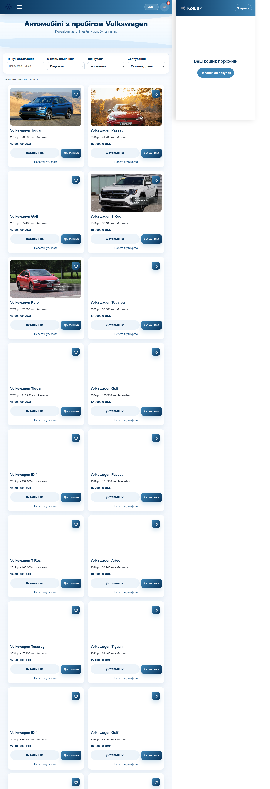
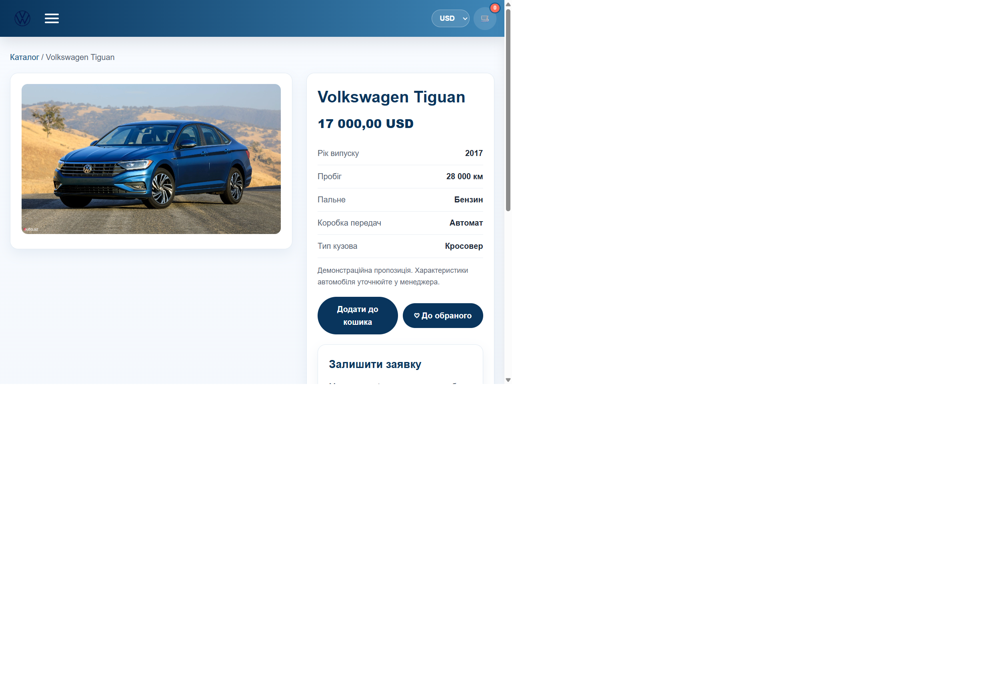
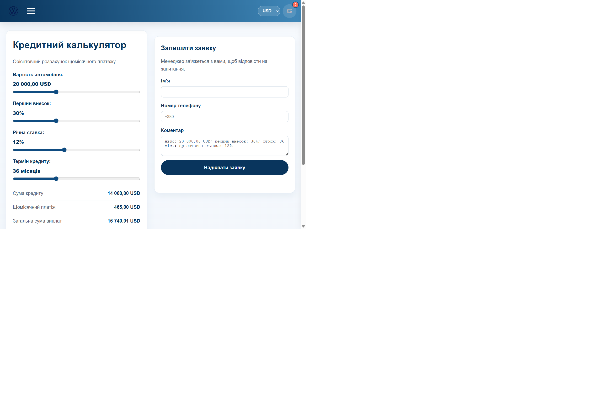

# Volkswagen — каталог автомобілів

Навчальний адаптивний сайт-каталог автомобілів Volkswagen на React і TypeScript. Дані каталогу та ціни демонстраційні; це не реальні оголошення дилера.

## Можливості

- Каталог із пошуком за моделлю, фільтром за кузовом і максимальною ціною та сортуванням.
- Окрема сторінка характеристик автомобіля (`/cars/:id`), список обраного та кошик зі збереженням у `localStorage`.
- Перемикач USD/EUR/UAH/GBP з курсами API НБУ та резервними курсами, якщо API недоступний.
- React-кредитний калькулятор із сумою кредиту, щомісячним платежем, загальною сумою та переплатою.
- Форми заявки на сторінці авто й кредитному калькуляторі. API передає заявки до CRM через захищений HTTPS webhook.
- Сторінки сервісу й кредитного калькулятора працюють через React Router. Старі адреси `credit.html` та `servise.html` перенаправляють на нові маршрути.
- Адаптивна верстка для мобільних і настільних екранів.

## Скріншоти

### Каталог



### Сторінка автомобіля



### Кредитний калькулятор



## Технології

- React 19, TypeScript, React Router
- Vite
- Express 5, CRM webhook
- Vitest, Testing Library, jsdom

## Запуск локально

Потрібен Node.js 22 або новіший.

```powershell
npm install
Copy-Item .env.example .env
npm run dev
```

Vite буде доступний за адресою `http://localhost:5173`, API — `http://localhost:3001`. Запускайте обидва процеси командою `npm run dev`. Для окремого запуску використовуйте `npm run dev:web` і `npm run dev:api`.

## Підключення CRM для заявок

Форма передає ім’я, телефон, тему заявки, коментар та джерело на налаштований HTTPS webhook CRM. У файлі `.env` задайте адресу webhook, яку надає ваша CRM або інтеграційний сервіс (наприклад, Make чи Zapier):

```env
PORT=3001
CRM_WEBHOOK_URL=https://crm.example.com/your-inbound-webhook
CRM_WEBHOOK_TOKEN=ваш-секретний-токен-якщо-потрібен
```

Збережіть `.env` локально: файл ігнорується Git. Не додавайте webhook-токен до репозиторію. Після налаштування endpoint-а перезапустіть API (`npm run dev:api` або `npm run dev`). Поки endpoint не заданий, API повідомляє, що інтеграцію не налаштовано, і не показує хибне підтвердження.

API перевіряє вміст заявки, обмежує частоту до 5 запитів на 15 хвилин з IP-адреси, використовує приховане поле-пастку проти спам-ботів і надсилає заявку лише на HTTPS endpoint. Персональні дані сайт локально не зберігає.

Формат webhook залежить від конкретної CRM. Якщо CRM не надає webhook для створення контакту/ліда, потрібен її API або автоматизація через Make/Zapier. Для production задайте webhook URL і токен як secrets на сервері, розмістіть API та фронтенд за одним origin або налаштуйте reverse proxy для `/api`, а для маршрутів React Router налаштуйте SPA fallback на `index.html`.

## Команди перевірки

```powershell
npm test
npm run build
npm run preview
```

Тести перевіряють фільтрацію й сортування каталогу, розрахунки кредиту, валідацію API-заявок і стани форми.

## Дані й обмеження демонстрації

- Каталог, характеристики й ціни створені для демонстрації інтерфейсу; уточнюйте реальні параметри автомобіля у менеджера.
- Курс НБУ використовується лише для відображення цін. Якщо запит не вдається, показуються резервні орієнтовні значення.
- Кошик зберігається в браузері. Його оформлення лишається демонстраційною дією; реальна заявка надсилається через форми на сторінці авто та кредиту.
- Розрахунок кредиту попередній і не є кредитною пропозицією.
